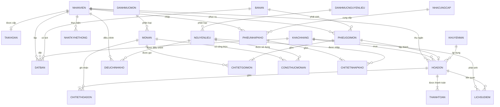

# Sơ đồ và từ điển cơ sở dữ liệu

Database: `HTQLNhaHang` — Microsoft SQL Server 2022.

## Nhóm bảng

| Nhóm | Bảng |
|---|---|
| Nhân sự và xác thực | `NhanVien`, `TaiKhoan`, `NhatKyHeThong` |
| Khách hàng | `KhachHang`, `LichSuDiem` |
| Bàn và đặt bàn | `BanAn`, `DatBan` |
| Thực đơn và order | `DanhMucMon`, `MonAn`, `PhieuGoiMon`, `ChiTietGoiMon` |
| Thanh toán | `KhuyenMai`, `HoaDon`, `ChiTietHoaDon`, `ThanhToan` |
| Kho | `DanhMucNguyenLieu`, `NguyenLieu`, `CongThucMonAn`, `NhaCungCap`, `PhieuNhapKho`, `ChiTietNhapKho`, `DieuChinhKho` |
| Cấu hình | `CauHinh` |

## ERD rút gọn

## Quy tắc khóa và toàn vẹn chính

- Khóa chính dùng `IDENTITY`; mã nghiệp vụ như `MaBanCode`, `MaMonCode`, `MaHoaDonCode` có ràng buộc `UNIQUE`.
- Các trạng thái được kiểm soát bằng `CHECK CONSTRAINT`.
- Số lượng, đơn giá, điểm và tổng tiền không được âm.
- `HoaDon.MaPhieu` là duy nhất: một order chỉ có một hóa đơn hoàn tất.
- `TaiKhoan.MaNhanVien` là duy nhất: một nhân viên có tối đa một tài khoản.
- `CongThucMonAn` dùng khóa ghép `(MaMon, MaNL)`.
- Database bật `READ_COMMITTED_SNAPSHOT` và `ALLOW_SNAPSHOT_ISOLATION` để giảm khóa đọc khi nhiều máy cùng thao tác.

## View và stored procedure

- `vw_HangDoiBep`: hàng đợi món tại bếp.
- `vw_NguyenLieuSapHet`: nguyên liệu chạm định mức tối thiểu.
- `vw_DoanhThuNgay`: doanh thu tổng hợp theo ngày.
- `usp_TimBanTrong`: tìm bàn theo khu vực và sức chứa.
- `usp_CanhBaoDatBanQuaHan`: chuyển lịch đặt quá hạn và trả trạng thái bàn.
